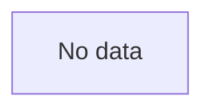

## Atomic view

The product vision is not documented yet. Describe the project's core purpose here.

## Users

| User | Description |
|------|-------------|
| placeholder | Users not documented yet. Describe who uses the product and how. |

## Feature catalog

### content

| slug | title | tldr |
|------|-------|------|
| `content-contract` | Content contract | projects.ts is the one project schema, links are http(s), v1.json its input-mode export; verify parses the locales, checks key parity and every asset. |

### infra

| slug | title | tldr |
|------|-------|------|
| `deploy-infrastructure` | Deploy infrastructure | One Terraform module serves the built site from a private S3 bucket through CloudFront, per env (stage, prod), applied and deployed by GitHub Actions over OIDC. |
| `local-servers` | Local Flask servers | backend/ holds Flask servers that serve frontend/dist on localhost; scripts start them; nothing in CI, deploy or the frontend uses them. |

### legacy

| slug | title | tldr |
|------|-------|------|
| `legacy-specs` | Legacy specs and screenshots | specs-bkp/ is the pre-canon specs tree kept by specs init and img/ holds site screenshots; both are reading material only, unread by the site and its gates. |

### media

| slug | title | tldr |
|------|-------|------|
| `scene-media` | Scene media pipeline and player | Scenes recorded from a pinned PyPI version, hash-named under byte budgets, played muted and looped, a still under reduced motion. |

### projects

| slug | title | tldr |
|------|-------|------|
| `dadaia-workspace-page` | dadaia-workspace project page | The library page for dadaia-workspace, pinned to PyPI 0.4.7 and tag v0.4.7, with a hero loop, three scenes, a pinned Try it and facts from the tag. |
| `library-page` | Library project page layout | The one library page layout - purpose, install line, hero loop, side-by-side scenes, Try it, Why it exists, facts pinned to a tag. |
| `rand-engine-page` | rand-engine project page | The library page for rand-engine, pinned to PyPI 0.8.0 and tag 0.8.0, with a hero loop, three scenes, a runnable Try it and facts from the tag. |

### quality

| slug | title | tldr |
|------|-------|------|
| `e2e-suite` | End-to-end suite | Playwright runs nine smoke specs on every PR and the full suite weekly, against a local server on port 8080 with the pt-BR locale. |

### resume

| slug | title | tldr |
|------|-------|------|
| `resume-home` | Resume home | The home is a frameless resume - hero, experience, two projects, skills, certifications, education - every number and word read from content. |

### site

| slug | title | tldr |
|------|-------|------|
| `analytics-sdk` | Analytics SDK | A vendored dependency-free SDK queues anonymous events per tab session and sends them by sendBeacon when the page hides. |
| `site-chrome` | Shared site chrome | One header and one footer on every route, one 960 px column with 680 px prose, one type scale, localized chrome strings and <html lang>. |

## Capability map

## Known limits

Limits not documented yet.
