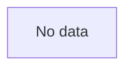

## Atomic view

The product vision is not documented yet. Describe the project's core purpose here.

## Users

| User | Description |
|------|-------------|
| placeholder | Users not documented yet. Describe who uses the product and how. |

## Feature catalog

### content

| slug | title | tldr |
|------|-------|------|
| `content-contract` | Content contract | projects.ts is the one project schema, every link is http(s), v1.json is its input-mode export, and verify parses the three locales and checks every asset. |

### media

| slug | title | tldr |
|------|-------|------|
| `scene-media` | Scene media pipeline and player | Scenes recorded from a pinned PyPI version, hash-named under byte budgets, played muted and looped, a still under reduced motion. |

### projects

| slug | title | tldr |
|------|-------|------|
| `dadaia-workspace-page` | dadaia-workspace project page | The library page for dadaia-workspace, pinned to PyPI 0.4.7 and tag v0.4.7, with a hero loop, three scenes, a pinned Try it and facts from the tag. |
| `library-page` | Library project page layout | The one library page layout - purpose, install line, hero loop, side-by-side scenes, Try it, Why it exists, facts pinned to a tag. |
| `rand-engine-page` | rand-engine project page | The library page for rand-engine, pinned to PyPI 0.8.0 and tag 0.8.0, with a hero loop, three scenes, a runnable Try it and facts from the tag. |

### site

| slug | title | tldr |
|------|-------|------|
| `site-chrome` | Shared site chrome | One header on every route, one type scale, a 960 px project column with 680 px prose, localized chrome strings and <html lang>. |

## Capability map

## Known limits

Limits not documented yet.
