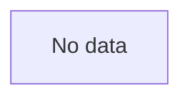

## Atomic view

The product vision is not documented yet. Describe the project's core purpose here.

## Users

| User | Description |
|------|-------------|
| placeholder | Users not documented yet. Describe who uses the product and how. |

## Feature catalog

### projects

| slug | title | tldr |
|------|-------|------|
| `dadaia-workspace-page` | dadaia-workspace project page | The portfolio's library-kind page for dadaia-workspace, in pt, en and de, stating its PyPI version, install line and links. |

## Capability map

## Known limits

Limits not documented yet.
